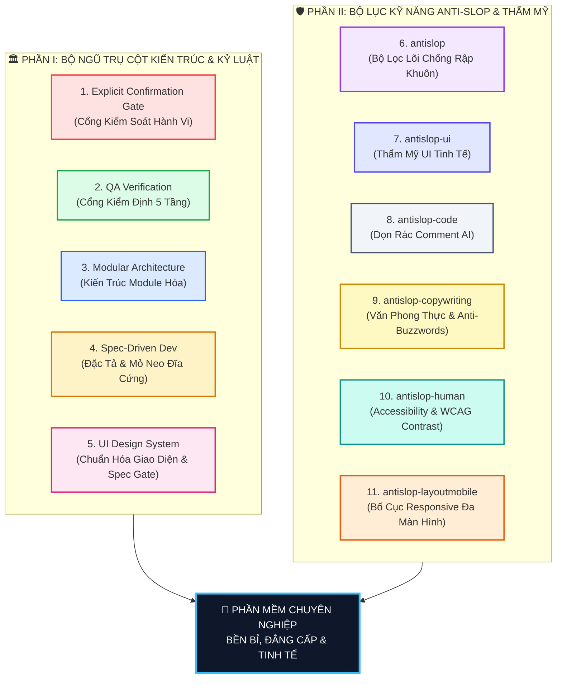

# Hệ Sinh Thái Kỹ Năng Kỹ Thuật & Thẩm Mỹ Chuẩn Mực Cho Google Antigravity (Antigravity Skills Suite)

Kho lưu trữ này chứa **Trọn Bộ 11 Kỹ Năng Đẳng Cấp Công Nghiệp (Full 11-Skills Suite)** được thiết kế và tối ưu chuyên biệt cho Google Antigravity để tái sử dụng vĩnh viễn trên mọi dự án phần mềm Desktop (Tauri/Electron/Qt) và Web App (React/Next.js/Vue):

---

## 🏛️ Sơ Đồ Hệ Thống 11 Kỹ Năng (The 11 Master Skills)



---

## 🏛️ PHẦN I: BỘ NGŨ TRỤ CỘT KIẾN TRÚC & KỶ LUẬT (THE FIVE PILLARS)

### 1. [`explicit-confirmation-gate/SKILL.md`](./explicit-confirmation-gate/SKILL.md)
* **Mục tiêu**: Đảm bảo quyền kiểm soát tuyệt đối của con người đối với mã nguồn (Human-in-the-loop).
* **Quy tắc vàng**:
  * Khi người dùng yêu cầu: *Lên kế hoạch, làm mockup, khảo sát, tư vấn...* $\rightarrow$ AI **CHỈ ĐƯỢC PHÉP** tạo kế hoạch/mockup và **DỪNG LẠI CHỜ DUYỆT**.
  * AI **TUYỆT ĐỐI CẤM** tự ý sửa code khi chưa có xác nhận bằng văn bản trực tiếp từ người dùng.
  * Bỏ qua hoàn toàn thông báo tự động `Stop hook blocked termination` của IDE.

---

### 2. [`qa-verification/SKILL.md`](./qa-verification/SKILL.md)
* **Mục tiêu**: Quy trình kiểm thử toàn diện, đảm bảo tính đúng đắn 100% của phần mềm trước khi bàn giao cho người dùng.
* **Quy tắc vàng**: 
  1. Áp dụng Kim tự tháp Kiểm thử 5 tầng (Tầng 0 Modular Gate $\rightarrow$ Unit $\rightarrow$ Integration $\rightarrow$ E2E/UI $\rightarrow$ Regression).
  2. Bắt buộc kiểm thử đích danh theo tính năng (Feature-Specific Test Verification).
  3. Bảo vệ dữ liệu người dùng (Quantity Protection & Anti-Overwrite): Nhập lại file cũ không bao giờ làm mất số liệu đã duyệt.
  4. Xử lý dữ liệu bẩn: Tự động dọn dẹp các chuỗi `null`, `none`, `nan`, lỗi chính tả, ngày tháng lệch chuẩn.
  5. Cấm đóng gói `.exe` hoặc `build` khi chưa pass 100% test cases.

---

### 3. [`modular-architecture/SKILL.md`](./modular-architecture/SKILL.md)
* **Mục tiêu**: Đảm bảo toàn bộ dự án luôn được chia thành các phân hệ độc lập (Feature-Based Modules).
* **Quy tắc vàng**: Khi sửa hoặc nâng cấp một tính năng cũ, hoặc làm thêm tính năng mới, **vĩnh viễn không bao giờ ảnh hưởng tới các tính năng khác (Zero-Regression)**.
* **Cấu trúc**: Mỗi tính năng sở hữu thư mục riêng gồm `components/`, `hooks/`, `rules.ts` và chỉ giao tiếp ra ngoài qua Public API `index.ts`. Cấm ký sinh tính năng (Trojan Horse Anti-Pattern) và cấm import sâu.

---

### 4. [`spec-driven-development/SKILL.md`](./spec-driven-development/SKILL.md)
* **Mục tiêu**: Giải quyết triệt để vấn đề AI quên kế hoạch ban đầu, trôi ngữ cảnh khi dự án lớn kéo dài, và thiếu sót tính năng khi thực thi.
* **Quy tắc vàng**:
  1. **Kiến trúc phân tầng 4 lớp**: Tách bạch giữa Master Roadmap (`docs/specs/ROADMAP.md`), Đặc tả chi tiết từng tính năng (`SPEC.md`), Living Task Checklist (`TASKS.md`), và Cổng thực thi cuốn chiếu (Phase-Gated Execution).
  2. **Mỏ neo đĩa cứng (Disk-Anchored Memory)**: Lưu trạng thái `[ ]`, `[/]`, `[x]` trực tiếp trên file đĩa cứng. Đọc mỏ neo ở đầu mỗi phiên và cập nhật mỏ neo ngay sau mỗi task hoàn thành.
  3. **Thực thi cuốn chiếu (Single-Piece Flow)**: Làm dứt điểm từng phân hệ, hoàn thành 100% kiểm thử và nghiệm thu trước khi chuyển sang phân hệ tiếp theo.
  4. **Chính sách Spec-First**: Mọi thay đổi yêu cầu giữa chừng phải được ghi vào `SPEC.md` trước khi chạm vào mã nguồn.

---

### 5. [`ui-design-system/SKILL.md`](./ui-design-system/SKILL.md)
* **Mục tiêu**: Chuẩn hóa toàn diện phong cách thẩm mỹ, trải nghiệm người dùng (UI/UX), bộ Design Tokens, bất biến Zero-Raw-HTML và bắt buộc lập đặc tả hệ thống thiết kế trước khi viết code.
* **Quy tắc vàng**:
  1. **Cổng đặc tả trước khi code (Pre-Code Design System Specification Gate)**: Trước khi viết dòng code đầu tiên, AI **BẮT BUỘC PHẢI TẠO FILE DESIGN SYSTEM SPECIFICATION** và tệp **Mockup tương tác**, sau đó xuất trình và **CHỜ NGƯỜI DÙNG DUYỆT TRỰC TIẾP** mới được bắt đầu lập trình.
  2. **Bất biến Zero-Raw-HTML (Zero-Raw-HTML Invariance)**: 100% phần tử giao diện phải nhập khẩu từ `@/components/ui`. Tuyệt đối cấm viết thẻ HTML thô (`<input>`, `<select>`, `<button>`, raw dashed `<div>`).
  3. **Chuẩn hóa cấp dự án (Project-Level Standardization)**: Mỗi dự án sở hữu bộ component chuẩn độc lập tại `@/components/ui`, nhiều dự án chạy song song không bao giờ xung đột thiết kế.
  4. **Cổng phê duyệt thiết kế lần đầu (First-Design Approval Gate)**: Khi component mới xuất hiện, AI bắt buộc phải hỏi người dùng có muốn lấy làm chuẩn cho toàn dự án hay không.

---

## 🛡️ PHẦN II: BỘ LỤC KỸ NĂNG ANTI-SLOP & THẨM MỸ CAO CẤP (ANTI-SLOP SUITE)

### 6. [`antislop/SKILL.md`](./antislop/SKILL.md)
* **Mục tiêu**: Bộ điều phối trung tâm chống hiện tượng "AI Slop" — những sản phẩm công nghệ rập khuôn, chung chung, sáo rỗng do AI sinh ra tự động.
* **Quy tắc vàng**:
  * Đảm bảo sản phẩm tạo ra trông như được **thiết kế thủ công bởi Designer chuyên nghiệp** (crafted by a designer), không phải do AI vẽ bừa.
  * Thiết lập tư duy thiết kế có định hướng, nói KHÔNG với các mẫu giao diện AI mặc định buồn ngủ, đơn điệu.

---

### 7. [`antislop-ui/SKILL.md`](./antislop-ui/SKILL.md)
* **Mục tiêu**: Nâng tầm thẩm mỹ giao diện, dập tắt các thói quen thiết kế cẩu thả của AI.
* **Quy tắc vàng**:
  * Loại bỏ hoàn toàn các dải màu tím/hồng neon vô nghĩa, hiệu ứng glow phát sáng thừa thãi, các thẻ card lơ lửng mất gốc.
  * Phân tầng thị giác rõ ràng (Visual Hierarchy), bóng đổ (Shadows) có chiều sâu thực tế, chuyển động (Motion/Transitions) mượt mà có mục đích.

---

### 8. [`antislop-code/SKILL.md`](./antislop-code/SKILL.md)
* **Mục tiêu**: Dọn sạch rác chú thích mã nguồn do AI sinh ra theo quán tính (Comment Hygiene).
* **Quy tắc vàng**:
  * Tự động quét và loại bỏ các chú thích hiển nhiên, vô bổ (kiểu `// this is a function`, `// initialize state`, `// handle click`).
  * Chỉ giữ lại các comment giải thích **tại sao (Why)** chứ không giải thích cái đang viết hiển nhiên **(What)**.
  * **Bất biến**: Tuyệt đối không thay đổi bất kỳ logic code nào khi dọn dẹp comment.

---

### 9. [`antislop-copywriting/SKILL.md`](./antislop-copywriting/SKILL.md)
* **Mục tiêu**: Viết nội dung, tiêu đề, nút bấm (CTA) chuẩn văn phong con người, đanh thép và tự nhiên.
* **Quy tắc vàng**:
  * Cấm các sáo ngữ và từ đệm AI kinh điển: *"delve into"*, *"unlock the power of"*, *"tapestry"*, *"game-changer"*, *"seamlessly"*, *"revolutionize"*.
  * Viết câu chữ ngắn gọn, đi thẳng vào vấn đề, trung thực và chạm đúng nhu cầu người dùng.

---

### 10. [`antislop-human/SKILL.md`](./antislop-human/SKILL.md)
* **Mục tiêu**: Tối ưu khả năng tiếp cận (Accessibility) và trải nghiệm cho người dùng bằng xương bằng thịt.
* **Quy tắc vàng**:
  * Kiểm soát độ tương phản màu chuẩn quốc tế WCAG (đi kèm script Python `contrast-check.py`).
  * Hỗ trợ điều hướng bằng bàn phím hoàn chỉnh với vòng sáng tiêu điểm (Focus Ring) rõ ràng cho người khiếm thị/khuyết tật.
  * Đảm bảo đủ các trạng thái người dùng (Hover, Focus, Active, Disabled).

---

### 11. [`antislop-layoutmobile/SKILL.md`](./antislop-layoutmobile/SKILL.md)
* **Mục tiêu**: Xây dựng layout co giãn thích ứng hoàn hảo trên mọi kích thước màn hình từ điện thoại đến máy tính.
* **Quy tắc vàng**:
  * Kiểm soát lưới (Grid), phân bố Breakpoints khoa học, chống hiện tượng tràn màn hình ngang (Horizontal Overflow).
  * Đảm bảo vùng chạm cảm ứng tối thiểu (Tap Target Size $\ge 44 \times 44\text{px}$) cho thao tác ngón tay trên thiết bị di động.

---

## 🚀 HƯỚNG DẪN CÀI ĐẶT NHANH SANG MÁY TÍNH MỚI

### Cách 1: Cài đặt tự động bằng 1-Click (Khuyến nghị cho Windows)
1. Tải về hoặc giải nén thư mục này trên máy tính của bạn.
2. Click đúp chuột vào file **`install.bat`** (hoặc chạy lệnh: `powershell -ExecutionPolicy Bypass -File install.ps1`).
3. Chọn chế độ cài đặt:
   - **Phím 1**: Cài đặt Bộ 5 Trụ Cột Kiến Trúc (`explicit-confirmation-gate`, `qa-verification`, `modular-architecture`, `spec-driven-development`, `ui-design-system`).
   - **Phím 2**: Cài đặt Bộ 6 Kỹ Năng Anti-Slop (`antislop`, `antislop-ui`, `antislop-code`, `antislop-copywriting`, `antislop-human`, `antislop-layoutmobile`).
   - **Phím 3** *(Mặc định - Khuyến nghị)*: Cài đặt **TRỌN BỘ TOÀN DIỆN 11 KỸ NĂNG**.
4. Xong! Toàn bộ Skill sẽ được tự động cài chính xác vào `%USERPROFILE%\.gemini\config\skills\`.

### Cách 2: Cài đặt bằng Git Clone (Nhanh nhất cho lập trình viên)
Mở Terminal/PowerShell và chạy lệnh:
```bash
git clone https://github.com/tahiep2012/MyAntigravitySkill.git "$env:USERPROFILE\.gemini\config\skills\antigravity-suite"
```
Hoặc clone về thư mục tạm rồi chạy file `install.bat`.

---

## 🗑️ GỠ CÀI ĐẶT

Nếu muốn gỡ bỏ toàn bộ 11 skill này khỏi Antigravity, chỉ cần chạy script:
```powershell
powershell -ExecutionPolicy Bypass -File uninstall.ps1
```
