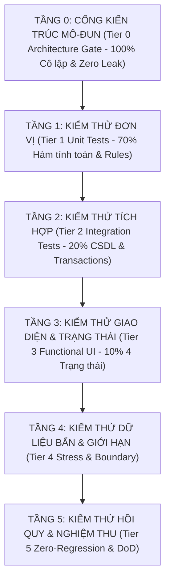

# Quy Trình Kiểm Thử Phần Mềm & Website Chuẩn Mực (QA & Verification Skill)

Bộ kỹ năng này là **Cổng Kiểm Định Chất Lượng Bắt Buộc (Mandatory Quality Gate)**. Hướng dẫn AI Agent và kỹ sư phần mềm áp dụng **Quy trình Kiểm thử Chất lượng Toàn diện (End-to-End QA Lifecycle)**. Đảm bảo mọi tính năng mới khi phát triển trên Web, Desktop App hoặc Hệ thống Backend đều hoạt động **chính xác 100%, bảo toàn dữ liệu, chống lỗi hồi quy (Zero-Regression) và chịu tải bền bỉ trước dữ liệu thực tế**.

---

## 0. Quy Tắc Bắt Buộc Tuyệt Đối (Non-Negotiable Mandates)

> [!CAUTION]
> **CẤM BIÊN DỊCH / ĐÓNG GÓI BINARY KHI CHƯA CHẠY KIỂM THỬ TỰ ĐỘNG**
> AI Agent **TUYỆT ĐỐI KHÔNG ĐƯỢC PHÉP**:
> 1. Chạy lệnh đóng gói ứng dụng (`npx tauri build`, `cargo build --release`, `npm run dist`, tạo `.exe`) khi chưa chạy bộ test tự động và chứng minh 100% test cases ĐẠT (`PASS`).
> 2. Báo cáo với người dùng là tính năng "đã hoàn thành" hoặc "đã sửa xong" nếu chưa kiểm thử xác nhận.
> 3. Bỏ qua việc kiểm thử hồi quy (Regression Test) đối với các tính năng cũ lân cận.
> 4. Bỏ qua kiểm tra tính cô lập kiến trúc mô-đun (Tier 0 Architecture Gate).
> 5. **Chỉ chạy lại bộ test cũ của phân hệ khác để đối phó khi có tính năng/thay đổi mới (Mandatory Feature-Specific Verification & Test Hygiene)**:
>    - Mỗi khi phát triển tính năng mới hoặc thay đổi nghiệp vụ, bộ test **BẮT BUỘC phải có test cases tương ứng bao quát trực tiếp tính năng/thay đổi đó**:
>      - **Tính năng mới (New Feature)**: Bổ sung các bài test mới kiểm tra đặc tả tính năng (tổng số test tăng lên tương ứng).
>      - **Thay thế / Tái cấu trúc (Refactor / Deprecation)**: Cập nhật hoặc thay thế bài test cũ của tính năng bị loại bỏ bằng bài test mới của tính năng thay thế (tránh phình to test vô ích).
>      - **Sửa lỗi (Bugfix)**: Bổ sung 1 bài test chứng minh lỗi đã được dập tắt (Regression Bug Test).
>      - **Tinh chỉnh giao diện nhỏ (Minor UI/CSS Polish)**: Cập nhật test hiện có nếu cần, không bắt buộc tăng số lượng test.
>    - Tuyệt đối cấm việc chỉ chạy lại bộ test cũ của các phân hệ khác mà hoàn toàn không có bài test nào xác nhận cho phần công việc vừa làm.

### Cơ Chế Tự Động Khóa Lỗi (Self-Enforcing Prebuild Gate):
Mỗi khi khởi tạo hoặc làm việc trên bất kỳ dự án nào, AI Agent phải đảm bảo file `package.json` hoặc cấu hình build luôn có lệnh chặn tự động:
```json
"scripts": {
  "test": "tsx tests/test_qa_lifecycle.ts",
  "prebuild": "npm run test",
  "build": "..."
}
```
*Tác dụng*: Nếu kỹ sư hoặc AI cố tình chạy `npm run build` mà quên test, trình biên dịch sẽ tự động chạy test trước. Nếu có dù chỉ 1 lỗi nhỏ (kể cả lỗi vi phạm kiến trúc mô đun hay lỗi nghiệp vụ), quá trình build sẽ bị HỦY NGAY LẬP TỨC (`exit code != 0`), bảo vệ triệt để môi trường sản phẩm.

---

## 1. Nguyên Tắc Cốt Lõi: Kim Tự Tháp Kiểm Thử 5 Tầng (The 5-Tier Test Pyramid)

Hệ thống kiểm thử tự động của mọi dự án BẮT BUỘC phải bao quát đủ 5 tầng:



1. **Tầng 0 (Bắt buộc tiên quyết) - Modular Architecture & Encapsulation Gate**:
   - Quét mã nguồn kiểm tra 100% module có file Public API `index.ts`.
   - Quét toàn bộ import để đảm bảo **tuyệt đối 0 có vi phạm import chọc sâu vào nội bộ module khác** (`components/`, `hooks/`).
   - Nếu vi phạm kiến trúc, test suite NGẮT NGAY TẠI TẦNG 0, không cho phép chạy các tầng tiếp theo!
2. **Tầng 1 (70% - Unit Tests)**:
   - Kiểm tra từng hàm tính toán, thuật toán phân loại, hàm làm sạch chuỗi, chuẩn hóa tiền tệ/ngày tháng. Nhanh, rẻ, chạy hàng chục test trong vài phần trăm giây.
3. **Tầng 2 (20% - Integration Tests)**:
   - Kiểm tra các khối ghép nối với Cơ sở dữ liệu (SQLite, PostgreSQL...).
   - Đảm bảo an toàn giao dịch (ACID Transactions): Rollback sạch sẽ khi có sự cố, không để lại rác trong database.
4. **Tầng 3 (10% - Functional UI & Interactive States)**:
   - Kiểm tra 4 trạng thái giao diện theo `ui-design-system`: Đang tải (`Loading`), Dữ liệu trống (`Empty`), Báo lỗi (`Error`), và Hiển thị thành công (`Success`).
   - Kiểm tra phản hồi phím tắt (F1-F5, Ctrl+F, Shift+F, Esc).
5. **Tầng 4 (Stress, Boundary & Dirty Data Testing)**:
   - Thử nghiệm dữ liệu bẩn: Tệp Excel chứa lỗi công thức (`#REF!`, `#VALUE!`), ký tự unicode lạ, chuỗi siêu dài, giá trị âm hoặc null/none.
   - Thử nghiệm bảo toàn dữ liệu (Anti-Overwrite Protection): Nhập lại file cũ không được ghi đè mất mát các dữ liệu đã duyệt.
6. **Tầng 5 (Zero-Regression & Definition of Done)**:
   - "Chữa mắt trái không được làm mù mắt phải": Khẳng định toàn bộ các phân hệ cũ tiếp tục hoạt động trơn tru.

---

## 2. Quy Trình Chuẩn 6 Bước Kiểm Thử Tính Năng Mới

Mỗi khi phát triển một tính năng mới (hoặc nâng cấp tính năng cũ), hãy tuân thủ tuần tự 6 bước sau:

### Giai đoạn 1: Thiết kế Kịch bản Kiểm thử & Mở Rộng Test Suite
Trước khi viết code hoặc chỉnh sửa tính năng:
1. Xác định phân hệ bị tác động (`src/modules/<feature_name>/`).
2. Thiết kế ngay các test cases mới tương ứng trực tiếp:
   - **Happy Path**: Giá trị đầu vào chuẩn, cấu hình mới hoạt động đúng.
   - **Negative / Cleanup Path**: Các cấu hình cũ/tính năng cũ bị xóa bỏ hoặc thay thế phải được xác nhận không còn tồn tại (Negative assertions).
   - **Edge / Boundary Cases**: Giá trị rỗng, giá trị cực đại, giá trị mặc định khi chưa có dữ liệu.
   - **Data Integrity Cases**: Lưu và đọc lại từ LocalStorage/Database chính xác 100%.

### Giai đoạn 2: Cài Đặt Tầng 0 & Kiểm Thử Đơn Vị (Unit Testing)
- Kiểm tra tính cô lập module của tính năng mới (`src/modules/<feature_name>/index.ts`).
- Viết unit tests cho các hàm tính toán thuần túy trong `rules.ts`.

### Giai đoạn 3: Kiểm Thử Tích Hợp & CSDL (Integration Testing)
- Khởi tạo môi trường Clean Slate.
- Kiểm tra ghi/đọc dữ liệu qua các transaction nguyên tử.

### Giai đoạn 4: Kiểm Thử Giao Diện & Trạng Thái UI (Functional UI Testing)
- Kiểm tra phản hồi thị giác và tương tác người dùng theo `ui-design-system`:
  - `Loading State`: Nút bấm có spinner, bị disable để chống spam click.
  - `Empty State`: Hình minh họa và chỉ dẫn thay vì màn hình trắng xóa.
  - `Error State`: Khung thông báo đỏ rõ ràng, hướng dẫn xử lý.
  - `Success State`: Banner/Toast xanh thông báo kết quả chi tiết.

### Giai đoạn 5: Kiểm Thử Dữ Liệu Bẩn & Giới Hạn (Stress & Boundary Testing)
- Kiểm tra chịu tải với dữ liệu dung lượng lớn.
- Bơm dữ liệu rác/lỗi xem ứng dụng có bị crash hay không.

### Giai đoạn 6: Nghiệm thu & Định Nghĩa Hoàn Thành (DoD)
Một tính năng chỉ được xem là **HOÀN THÀNH (DONE)** khi:
- [ ] Cổng Tầng 0 (Kiến trúc mô-đun) PASS 100%: 0 rò rỉ ranh giới module.
- [ ] **BẮT BUỘC có các bài test tương ứng bao quát trực tiếp tính năng/chỉnh sửa vừa thực hiện** (test mới cho tính năng mới, hoặc test cập nhật/thay thế cho tính năng tái cấu trúc).
- [ ] 100% Test cases (bao gồm cả test mới lẫn test hồi quy Tầng 1 - Tầng 5) chạy đạt PASS.
- [ ] Toàn bộ mã nguồn biên dịch thành công (`exit code: 0`).
- [ ] Tuân thủ `ui-design-system`: Tái sử dụng Atomic Components chuẩn, đủ 4 trạng thái giao diện.
- [ ] 0 lỗi hồi quy đối với các phân hệ lân cận.
- [ ] File thực tế (`.exe` hoặc website) hoạt động mượt mà.

---

## 3. Mẫu Kịch Bản Kiểm Thử Tự Động Tầng 0 Chuẩn (Copy-Pasteable Boilerplate)

Khi bắt đầu một dự án mới, AI Agent BẮT BUỘC chèn đoạn mã Tầng 0 này vào đầu file test suite trung tâm:

```typescript
import fs from 'fs';
import path from 'path';

// -------------------------------------------------------------
// TẦNG 0: MODULAR ARCHITECTURE & ENCAPSULATION GATE
// -------------------------------------------------------------
console.log('▶ 0. CỔNG KIỂM TRA KIẾN TRÚC MÔ-ĐUN (MODULAR ARCHITECTURE GATE)');

const modulesDir = path.resolve(process.cwd(), 'src/modules');
if (fs.existsSync(modulesDir)) {
  const moduleList = fs.readdirSync(modulesDir).filter((item) => {
    return fs.statSync(path.join(modulesDir, item)).isDirectory();
  });

  // 0.1 Mọi module bắt buộc phải có file index.ts (Public API)
  moduleList.forEach((mod) => {
    const indexPath = path.join(modulesDir, mod, 'index.ts');
    const hasIndex = fs.existsSync(indexPath);
    if (!hasIndex) {
      console.error(`❌ [FAIL] Module "${mod}" THIẾU file index.ts làm Public API!`);
      process.exit(1);
    }
  });

  // 0.2 Quét ranh giới mô-đun: Cấm chọc thẳng vào file con của module khác
  function scanModuleViolations(dir: string): string[] {
    let violations: string[] = [];
    const entries = fs.readdirSync(dir, { withFileTypes: true });

    for (const entry of entries) {
      const fullPath = path.join(dir, entry.name);
      if (entry.isDirectory()) {
        violations = violations.concat(scanModuleViolations(fullPath));
      } else if (entry.name.endsWith('.ts') || entry.name.endsWith('.tsx')) {
        const content = fs.readFileSync(fullPath, 'utf-8');
        const lines = content.split('\n');

        lines.forEach((line, idx) => {
          const importMatch = line.match(/from\s+['"](\.\.\/[^'"]+|@\/modules\/[^'"]+)['"]/);
          if (importMatch) {
            const importPath = importMatch[1];
            for (const otherMod of moduleList) {
              const relToModules = path.relative(modulesDir, fullPath);
              const currentMod = relToModules.split(path.sep)[0];
              if (currentMod !== otherMod && 
                 (importPath.includes(`/${otherMod}/components/`) || 
                  importPath.includes(`../${otherMod}/components/`) ||
                  importPath.includes(`/${otherMod}/hooks/`) ||
                  importPath.includes(`../${otherMod}/hooks/`))) {
                violations.push(`${path.relative(process.cwd(), fullPath)}:${idx + 1} chọc trực tiếp vào nội bộ module ${otherMod}`);
              }
            }
          }
        });
      }
    }
    return violations;
  }

  const archViolations = scanModuleViolations(modulesDir);
  if (archViolations.length > 0) {
    console.error('❌ [FAIL] PHÁT HIỆN VI PHẠM ĐÓNG GÓI RANH GIỚI MÔ-ĐUN:');
    archViolations.forEach(v => console.error(`  - ${v}`));
    process.exit(1);
  }
  console.log(`  ✅ [PASS] 100% ${moduleList.length} modules đạt chuẩn cô lập, Zero Encapsulation Leak!`);
}
```

---

## 4. Tóm Tắt Khẩu Quyết Cho Người Làm Phần Mềm

> 1. **Code cho máy chạy là bình thường, code có kiểm thử tự động chứng minh sự chính xác mới là chuyên nghiệp.**
> 2. **Luôn khóa biên dịch bằng prebuild hook (`"prebuild": "npm run test"`) để không bao giờ xuất bản sản phẩm lỗi.**
> 3. **Kiểm tra kiến trúc mô-đun (Tier 0) là bước kiểm tra đầu tiên trước khi chạy bất kỳ test nghiệp vụ nào.**
> 4. **Bảo vệ tính toàn vẹn của dữ liệu là ưu tiên số 1 (Dữ liệu mất đi không lấy lại được).**
> 5. **Mỗi lần sửa một dòng code, hãy tự hỏi: "Tính năng cũ bên cạnh có bị ảnh hưởng không?"**
> 6. **Tính năng mới phải có bài test tương ứng. Không dùng bộ test cũ của phân hệ khác để nghiệm thu phần việc vừa làm.**
