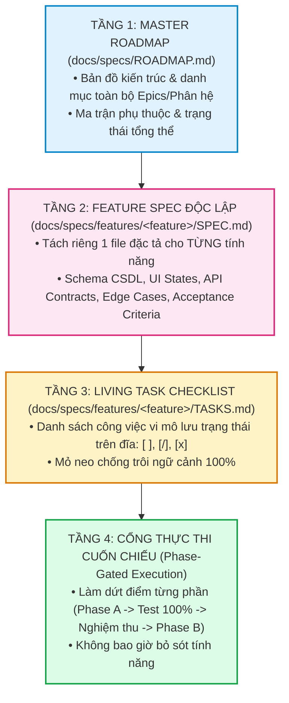
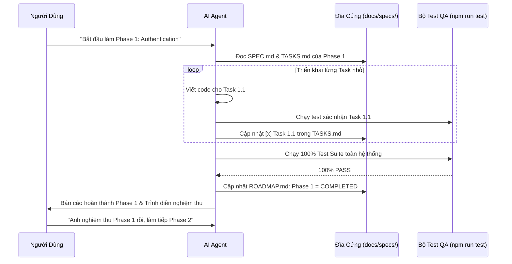

# Phát Triển Theo Đặc Tả Phân Tầng & Quản Trị Lộ Trình Dự Án Lớn (Spec-Driven Development Skill)

Bộ kỹ năng này là **Quy Chuẩn Quản Trị Dự Án & Kiểm Soát Lộ Trình Bắt Buộc (Mandatory Project Roadmap & Execution Standard)** dành cho AI Agent và Kỹ sư phần mềm khi triển khai các dự án quy mô vừa và lớn (Enterprise & Multi-Module Projects). 

Kỹ năng này giải quyết triệt để vấn đề:
1. **Lập kế hoạch phân tầng**: Tách bạch giữa Kế hoạch tổng quan toàn hệ thống (Master Roadmap) và Kế hoạch chi tiết độc lập cho từng tính năng (Feature-Specific Deep-Dive Specs).
2. **Chống trôi ngữ cảnh & chống quên (Anti-Context Drift & Disk-Anchored Memory)**: Lưu trạng thái công việc và đặc tả trực tiếp trên file đĩa cứng (`docs/specs/`), loại bỏ hoàn toàn việc "quên kế hoạch ban đầu" khi cửa sổ ngữ cảnh bị đầy hoặc session kéo dài.
3. **Thực thi cuốn chiếu & nghiệm thu từng phần (Phase-Gated Incremental Execution)**: Triển khai dứt điểm từng phân hệ, hoàn thành 100% kiểm thử và nghiệm thu trước khi chuyển sang phân hệ kế tiếp.

---

## 0. Quy Tắc Bắt Buộc Tuyệt Đối (Non-Negotiable Mandates)

> [!CAUTION]
> **CẤM DỒN KẾ HOẠCH NGUYÊN KHỐI VÀO CHAT KHI LÀM DỰ ÁN LỚN**
> 
> Khi tiếp nhận một dự án lớn, tính năng phức tạp hoặc hệ thống đa phân hệ, AI Agent **TUYỆT ĐỐI KHÔNG ĐƯỢC PHÉP**:
> 1. Chỉ tạo 1 file kế hoạch chung chung duy nhất (`implementation_plan.md`) rồi tiến hành code hàng loạt.
> 2. Chỉ trao đổi và lưu trữ các chi tiết kỹ thuật trong lịch sử tin nhắn Chat (dẫn đến trôi ngữ cảnh và quên sạch yêu cầu ban đầu).
> 3. Triển khai dàn trải cùng lúc nhiều phân hệ mà không đóng gói dứt điểm từng phần.
> 4. Nhảy sang Phân hệ B khi Phân hệ A chưa đạt 100% tiêu chí nghiệm thu (Definition of Done) và chưa pass toàn bộ bộ test.
> 5. Bắt đầu viết code khi chưa có file đặc tả tính năng (`docs/specs/features/<feature>/SPEC.md`) và danh sách công việc (`TASKS.md`) tương ứng trên đĩa cứng.

---

## 1. Kiến Trúc Phân Tầng 4 Lớp (The 4-Tier Planning Architecture)

Mọi dự án lớn được quản trị theo mô hình kim tự tháp đặc tả 4 tầng:



---

## 2. Cấu Trúc Thư Mục Lưu Trữ Đặc Tả Chuẩn (`docs/specs/`)

Mọi dự án áp dụng kỹ năng này BẮT BUỘC phải duy trì cấu trúc thư mục sau tại gốc dự án:

```text
my-project/
├── docs/specs/
│   ├── ROADMAP.md                  # TẦNG 1: Lộ trình tổng thể & Ma trận trạng thái các Epic
│   ├── ARCHITECTURE.md             # Sơ đồ kiến trúc, luồng dữ liệu & ranh giới mô-đun
│   └── features/                   # TẦNG 2 & 3: TÁCH RIÊNG TỪNG PHÂN HỆ
│       ├── 01-authentication/      # Phân hệ 1: Xác thực & Phân quyền
│       │   ├── SPEC.md             # Đặc tả chi tiết: UI, DB schema, logic, mã lỗi
│       │   └── TASKS.md            # Checklist công việc có lưu trạng thái [x]
│       ├── 02-order-management/    # Phân hệ 2: Quản lý Đơn hàng
│       │   ├── SPEC.md
│       │   └── TASKS.md
│       ├── 03-warehouse/           # Phân hệ 3: Kho vận
│       │   ├── SPEC.md
│       │   └── TASKS.md
│       └── 04-reports-export/      # Phân hệ 4: Báo cáo & Xuất dữ liệu
│           ├── SPEC.md
│           └── TASKS.md
```

---

## 3. Chi Tiết Từng Tầng Kế Hoạch

### 3.1. Tầng 1: Master Roadmap (`docs/specs/ROADMAP.md`)
- **Mục đích**: Cung cấp bức tranh toàn cảnh (Bird's Eye View) về lộ trình dự án từ ngày bắt đầu đến khi release.
- **Nội dung bắt buộc**:
  1. **Mục tiêu dự án & Giá trị cốt lõi**.
  2. **Bảng phân rã các Phân hệ (Epic Breakdown Table)**:
     | Mã Epic | Tên Phân hệ | Mức độ ưu tiên | Trạng thái | Thư mục Spec |
     | :--- | :--- | :--- | :--- | :--- |
     | `EPIC-01` | Quản lý Đơn hàng (PO/OD) | P0 (Bắt buộc) | `COMPLETED` | `docs/specs/features/01-orders/` |
     | `EPIC-02` | Kế hoạch Chi tiêu | P1 (Cao) | `IN_PROGRESS` | `docs/specs/features/02-payment-plan/` |
     | `EPIC-03` | Xuất RPA Power Automate | P1 (Cao) | `PENDING` | `docs/specs/features/03-rpa/` |
  3. **Ma trận phụ thuộc (Dependency Graph)**: Phân hệ nào phải làm trước, phân hệ nào kế thừa.
  4. **Quy ước phiên bản & Lộ trình phát hành (Milestones & Releases)**.

---

### 3.2. Tầng 2: File Đặc Tả Chi Tiết Từng Tính Năng (`SPEC.md`)
> [!IMPORTANT]
> **MỖI PHÂN HỆ / TÍNH NĂNG LỚN BẮT BUỘC PHẢI CÓ 1 FILE `SPEC.md` RIÊNG BIỆT.**

Một file `SPEC.md` đạt chuẩn phải bao gồm đủ 7 mục bắt buộc:
1. **Tổng quan & User Stories**: Người dùng là ai? Muốn làm gì? Để đạt mục đích gì?
2. **Ranh giới Mô-đun & Kiến trúc**: Áp dụng chuẩn `modular-architecture`, chỉ rõ các file dự kiến tạo/sửa.
3. **Mô hình Dữ liệu (Data Schema & Types)**: Bảng CSDL mới, migration, trường dữ liệu, kiểu dữ liệu TypeScript.
4. **Đặc tả Giao diện & Trạng thái UI (UI State Machine)**:
   - Đủ 4 trạng thái chuẩn `ui-design-system`: `Loading`, `Empty`, `Error`, `Success`.
   - Layout chi tiết, vị trí nút bấm, icon Lucide, phím tắt (Keyboard Shortcuts).
5. **Quy tắc Nghiệp vụ & Thuật toán (Business Rules & Formulas)**: Các công thức tính toán, logic phân loại, điều kiện lọc.
6. **Xử lý Biên & Dữ liệu Bẩn (Edge Cases & Dirty Data)**: Xử lý dữ liệu rỗng, trùng lặp, số âm, ký tự đặc biệt, ngắt kết nối mạng.
7. **Tiêu Chí Nghiệm Thu (Acceptance Criteria / Definition of Done)**: Danh sách các điều kiện cụ thể để xác nhận phân hệ đã hoàn thành 100%.

---

### 3.3. Tầng 3: Living Task Checklist (`TASKS.md`) - Mỏ Neo Đĩa Cứng
- **Cơ chế chống trôi ngữ cảnh (Anti-Context Drift Mechanism)**:
  - Khi một phiên làm việc kéo dài qua nhiều giờ hoặc nhiều ngày, ngữ cảnh trong chat sẽ bị cắt tỉa (truncated).
  - File `TASKS.md` là **vật chứng duy nhất** lưu trữ sự thật khách quan (Single Source of Truth).
  - AI Agent bắt buộc phải đọc file này ở đầu mỗi lượt làm việc để biết chính xác:
    - Công việc nào đã xong (`[x]`).
    - Công việc nào đang làm dở (`[/]`).
    - Công việc nào chưa bắt đầu (`[ ]`).
- **Quy ước đánh dấu**:
  - `[ ]`: Chưa làm.
  - `[/]`: Đang triển khai (kèm mô tả bước hiện tại).
  - `[x]`: Đã hoàn thành (kèm bằng chứng: test pass, commit hash, ngày giờ hoàn thành).

---

### 3.4. Tầng 4: Cổng Thực Thi Cuốn Chiếu (Phase-Gated Protocol)



**Quy tắc vận hành cổng**:
1. **Một việc tại một thời điểm (Single-Piece Flow)**: Không bao giờ vừa làm Authentication vừa làm Order Management.
2. **Khóa chặt trước khi chuyển bước**: Không chuyển sang Phase tiếp theo nếu Phase hiện tại còn dù chỉ 1 task `[ ]` chưa pass.
3. **Cập nhật tài liệu sống tức thì**: Ngay khi code xong 1 hàm hoặc 1 component, AI phải mở file `TASKS.md` và đổi `[ ]` thành `[x]`.

---

## 4. Quy Trình 5 Bước Vận Hành Dự Án Lớn

### Bước 1: Tiếp Nhận & Khảo Sát Dự Án (Discovery & Architecture Scoping)
- Lắng nghe toàn bộ yêu cầu dự án lớn từ người dùng.
- Phân tích ranh giới hệ thống, cơ sở dữ liệu, các bên liên quan.

### Bước 2: Thiết Lập Bộ Khung Đặc Tả Trên Đĩa (Scaffold Specs)
- Chạy script hoặc tạo cấu trúc `docs/specs/`.
- Tạo file `docs/specs/ROADMAP.md` liệt kê toàn bộ các Phân hệ (Epics) và phân kỳ Phase 1, Phase 2, Phase 3...
- Tạo các thư mục `docs/specs/features/<feature>/` tương ứng.

### Bước 3: Soạn Thảo SPEC.md Chi Tiết Cho Từng Phân Hệ
- Viết trọn vẹn file `SPEC.md` cho phân hệ đầu tiên cần làm.
- Phân rã thành danh sách công việc `TASKS.md` với các bước nhỏ có thể kiểm chứng được (< 2 giờ làm việc cho mỗi task).
- Trình bày kế hoạch chi tiết cho người dùng và chờ lệnh duyệt theo chuẩn `explicit-confirmation-gate`.

### Bước 4: Thực Thi Cuốn Chiếu (Execute, Test & Mark Checklist)
- Chỉ bắt đầu code khi người dùng ra lệnh rõ ràng ("Triển khai Phase 1 đi em").
- Thực hiện tuần tự từng task trong `TASKS.md`:
  - Viết Unit/Integration/UI code.
  - Viết Test case tương ứng trong bộ test (`qa-verification`).
  - Chạy `npm run test` chứng minh pass 100%.
  - Đánh dấu `[x]` vào `TASKS.md`.

### Bước 5: Nghiệm Thu Giai Đoạn & Chuyển Tiếp (Phase Gate Review)
- Đóng gói ứng dụng thử nghiệm, chạy demo hoặc cung cấp bản build.
- Cập nhật trạng thái `COMPLETED` trong `ROADMAP.md`.
- Trình bày báo cáo nghiệm thu Phase cho người dùng.
- Chờ chỉ thị từ người dùng trước khi bắt đầu Phase tiếp theo.

---

## 5. Danh Mục Các Lỗi Vi Phạm Cấm Kỵ (Anti-Patterns)

| Lỗi Vi Phạm | Hậu Quả Nguy Hiểm | Biện Pháp Khắc Phục Bắt Buộc |
| :--- | :--- | :--- |
| **"Kế hoạch trong miệng" (Ephemeral Plan)** | Chỉ nói mồm hoặc viết vài gạch đầu dòng trong chat, 10 tin nhắn sau trôi mất sạch. | **Bắt buộc** tạo file `docs/specs/features/<feature>/SPEC.md` trước khi chạm vào file code đầu tiên. |
| **"Nhảy cóc giai đoạn" (Phase Jumping)** | Đang làm dở Phân hệ A thấy Phân hệ B hay hay liền nhảy qua làm B, cuối cùng cả 2 đều dang dở. | **Bắt buộc** hoàn thành 100% checklist của Phase A và pass 100% test mới được chuyển sang Phase B. |
| **"Quên đánh dấu tiến độ" (Silent Work)** | Code xong nhưng không sửa file `TASKS.md`. Khi reload session, AI không biết mình đã làm gì. | **Bắt buộc** gọi tool cập nhật `[x]` vào `TASKS.md` ngay sau mỗi bước hoàn thành kèm test pass. |
| **"Phình to kế hoạch một file" (Giant Monolith)** | Nhét 50 trang tài liệu của 10 phân hệ vào 1 file duy nhất khiến việc đọc/ghi cực kỳ tốn context và dễ xung đột. | **Bắt buộc** chia nhỏ: 1 file `ROADMAP.md` tổng và mỗi phân hệ sở hữu riêng 1 thư mục `features/<feature>/`. |
