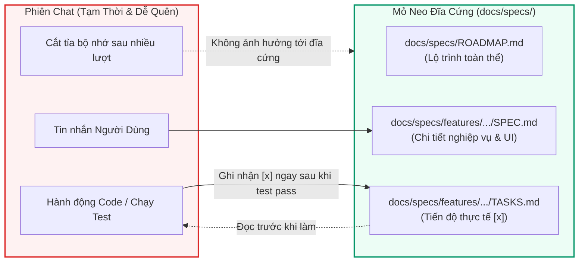

# Giao Thức Chống Trôi Ngữ Cảnh & Mỏ Neo Bộ Nhớ Đĩa Cứng (Anti-Context Drift Protocol)

Tài liệu này giải thích cơ chế khoa học đằng sau hiện tượng **"AI quên kế hoạch ban đầu"** trong các dự án phần mềm quy mô lớn, và đưa ra giải pháp kỹ thuật triệt để bằng **Mỏ Neo Đĩa Cứng (Disk-Anchored Memory)**.

---

## 1. Bản Chất Khoa Học Của Hiện Tượng Trôi Ngữ Cảnh (Context Drift)

Khi một AI Agent làm việc trên một dự án phần mềm lớn, một phiên làm việc điển hình diễn ra như sau:
1. Người dùng mô tả bài toán lớn với hàng chục yêu cầu chi tiết.
2. AI Agent lập một kế hoạch hoành tráng trong tin nhắn Chat hoặc tạo 1 file `implementation_plan.md` tạm bợ.
3. Bắt đầu code: Hàng loạt tool calls diễn ra (đọc file, ghi file, log build, stack trace, kết quả test).
4. **Hiện tượng cắt tỉa ngữ cảnh (Context Truncation / Attention Dilution)**:
   - Các mô hình ngôn ngữ lớn (LLMs) hoạt động trên một cửa sổ ngữ cảnh (Context Window) hữu hạn.
   - Khi phiên làm việc kéo dài, các tin nhắn ban đầu bị nén (summarized) hoặc đẩy ra ngoài vùng chú ý của mô hình.
   - AI bắt đầu bị "mất trí nhớ có chọn lọc": quên các điều kiện biên, quên các phím tắt đã giao ước, quên thứ tự sắp xếp cột, tự ý sửa theo logic mặc định của AI mà không bám sát yêu cầu ban đầu của người dùng.
5. **Hậu quả**: Dự án bị thiếu tính năng, người dùng phải giải thích lại từ đầu, code sau phá code trước.

---

## 2. Giải Pháp: Mỏ Neo Đĩa Cứng (The Disk-Anchored Memory Principle)

> [!IMPORTANT]
> **Bộ nhớ trong chat là tạm thời (Ephemeral). Bộ nhớ trên đĩa cứng là vĩnh cửu (Permanent).**

Để loại bỏ 100% hiện tượng trôi ngữ cảnh, toàn bộ thông tin quan trọng của dự án không bao giờ được phép để trôi nổi trong Chat. Thay vào đó, chúng được cấu trúc hóa và **neo chặt trực tiếp vào hệ thống tệp trên đĩa cứng**:

---

## 3. Quy Trình Vận Hành Mỏ Neo (The Wakeup & Grounding Routine)

Bất kể một phiên chat mới bắt đầu hay một phiên chat cũ bị nén ngữ cảnh, AI Agent bắt buộc phải thực thi **Quy Trình Định Vị Tọa Độ (Grounding Routine)**:

### Bước 1: Đọc Định Vị (Read Anchor First)
Trước khi đưa ra bất kỳ phản hồi hoặc viết bất kỳ dòng mã nào, Agent phải:
1. Đọc file `docs/specs/ROADMAP.md` để biết toàn bộ hệ thống đang ở Phase nào.
2. Đọc file `docs/specs/features/<current-feature>/TASKS.md` để thấy rõ:
   - Các task đã hoàn tất (`[x]`).
   - Task chính xác đang làm dở (`[/]`).
   - Task chuẩn bị thực hiện kế tiếp (`[ ]`).

### Bước 2: Thực Hiện Đơn Nhiệm & Viết Test
- Chỉ tập trung giải quyết DUY NHẤT một task kế tiếp trong danh sách `[ ]`.
- Viết mã nguồn kèm test case kiểm thử tương ứng.
- Chạy kiểm thử tự động xác nhận thành công.

### Bước 3: Cập Nhật Mỏ Neo Ngay Lập Tức (Atomic Anchor Update)
- Không bao giờ giữ trạng thái trong đầu.
- Gọi công cụ sửa file để đổi `[ ]` thành `[x]` trong `TASKS.md` kèm ghi chú thời gian và bằng chứng test pass.
- Nếu việc hoàn thành task này làm hoàn thành toàn bộ Phase, cập nhật luôn trạng thái trong `ROADMAP.md`.

---

## 4. Chính Sách "Sửa Đặc Tả Trước Khi Sửa Code" (Spec-First Policy for Mid-Stream Changes)

Trong quá trình triển khai dự án lớn, người dùng thường xuyên thay đổi yêu cầu hoặc bổ sung ý tưởng mới.

> [!CAUTION]
> **CẤM NHẢY THẲNG VÀO SỬA CODE KHI NGƯỜI DÙNG THAY ĐỔI YÊU CẦU**

Khi người dùng nói: *"Anh muốn đổi cách sắp xếp danh sách"*, hoặc *"Thêm cho anh một nút tra cứu nhanh"*:
1. **Bước 1**: Mở file `SPEC.md` của tính năng đó ra.
2. **Bước 2**: Bổ sung hoặc chỉnh sửa yêu cầu vào mục tương ứng (Mục 4 UI hoặc Mục 5 Nghiệp vụ) trong `SPEC.md`.
3. **Bước 3**: Thêm task mới vào `TASKS.md`.
4. **Bước 4**: Xác nhận với người dùng theo chuẩn `explicit-confirmation-gate`.
5. **Bước 5**: Chỉ tiến hành viết code sau khi đặc tả trên đĩa đã được cập nhật chính thức.

---

## 5. Kết Luận
Việc áp dụng Giao Thức Chống Trôi Ngữ Cảnh biến AI Agent từ một trợ lý trò chuyện ngẫu hứng thành một **kỹ sư phần mềm kỷ luật cao**, luôn nắm rõ mình đang ở đâu, đã làm được gì và cần làm gì tiếp theo mà không bao giờ bị phụ thuộc vào độ dài của lịch sử tin nhắn.
