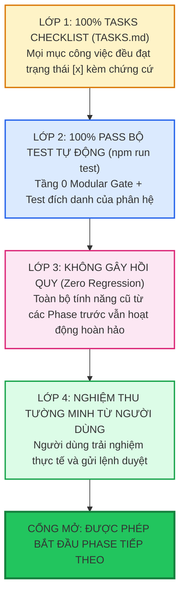

# Hướng Dẫn Quản Trị Cổng Thực Thi Cuốn Chiếu (Phase-Gating & Single-Piece Flow Guide)

Tài liệu này hướng dẫn nguyên lý quản trị dòng chảy công việc theo **Giai Đoạn Đóng Cổng (Phase Gating)** và phương pháp **Dòng Chảy Một Sản Phẩm (Single-Piece Flow)**, ngăn chặn triệt để tình trạng làm dàn trải, dở dang nhiều tính năng cùng lúc trong dự án lớn.

---

## 1. So Sánh: Dàn Trải Hàng Loạt (Batching) vs. Cuốn Chiếu Đóng Cổng (Single-Piece Flow)

| Tiêu Chí | Dàn Trải Hàng Loạt (Batch & Queue - CẤM) | Cuốn Chiếu Đóng Cổng (Phase-Gated - BẮT BUỘC) |
| :--- | :--- | :--- |
| **Cách thức làm** | Viết dở dang 5 tính năng cùng một lúc, mỗi chỗ đụng vào một ít. | Tập trung 100% năng lực hoàn thiện trọn vẹn 1 tính năng, xong xuôi mới chuyển tính năng khác. |
| **Trạng thái phần mềm** | Toàn bộ ứng dụng luôn ở trạng thái lỗi compile hoặc nửa vời, không chạy được. | Ứng dụng luôn luôn ở trạng thái chạy được (Always Deployable) sau mỗi giai đoạn. |
| **Khả năng phát hiện lỗi** | Khi chạy thử xuất hiện hàng trăm lỗi chồng chéo, không biết lỗi bắt nguồn từ đâu. | Lỗi phát sinh đến đâu được cô lập và sửa ngay lập tức tại phân hệ đó. |
| **Tâm lý người dùng** | Lo lắng vì sau nhiều ngày không thấy tính năng nào dùng được trọn vẹn. | Yên tâm và tin tưởng vì thấy từng phân hệ lần lượt chạy hoàn hảo và có thể dùng thật. |

---

## 2. Tiêu Chí Vượt Cổng Nghiệm Thu 4 Lớp (The 4-Layer Gate Criteria)

Một Giai đoạn (Phase / Epic) chỉ được phép coi là hoàn thành và cho phép chuyển sang Giai đoạn tiếp theo khi và chỉ khi thỏa mãn **toàn bộ 4 lớp tiêu chuẩn**:

---

## 3. Quản Lý Sự Phụ Thuộc Giữa Các Phân Hệ (Decoupled Dependencies)

Khi Phân hệ B phụ thuộc vào dữ liệu của Phân hệ A:
1. **Nguyên tắc hợp đồng ổn định (Stable Contract Principle)**:
   - Phân hệ A phải export kiểu dữ liệu (`types.ts`) và hàm Public qua `index.ts`.
   - Phân hệ B chỉ được phép phụ thuộc vào Interface này.
2. **Kỹ thuật Mocking trong kiểm thử**:
   - Nếu Phân hệ A chưa được làm tới, Phân hệ B bắt buộc phải tạo dữ liệu giả lập (Mock Data) độc lập trong thư mục test để kiểm chứng logic nội bộ mà không được phép phụ thuộc cứng vào code chưa hoàn thành của Phân hệ A.

---

## 4. Giao Thức Đóng Băng & Hồi Phục Khi Thất Bại Nghiệm Thu (Rollback & Fix Protocol)

Nếu trong quá trình nghiệm thu, người dùng phát hiện phân hệ hiện tại chưa đạt kỳ vọng:
1. **Đóng băng toàn bộ dự án**: Tuyệt đối KHÔNG ĐƯỢC chuyển sang phân hệ kế tiếp.
2. **Ghi nhận phản hồi vào `SPEC.md`**: Cập nhật mục 7 Tiêu chí nghiệm thu với các trường hợp bị lỗi.
3. **Mở lại task trong `TASKS.md`**: Đổi các task liên quan từ `[x]` về `[/]` hoặc tạo thêm task bổ sung.
4. **Sửa lỗi & chạy lại 100% test**: Thực hiện chu trình kiểm thử cho đến khi pass toàn bộ.
5. **Yêu cầu nghiệm thu lại**: Trình diễn kết quả khắc phục cho người dùng.

---

## 5. Tóm Tắt Tuyên Ngôn Cuốn Chiếu

> *"Thà hoàn thành xuất sắc 1 tính năng chạy hoàn hảo, còn hơn tạo ra 10 tính năng nửa vời không thể đưa vào sản xuất."*
