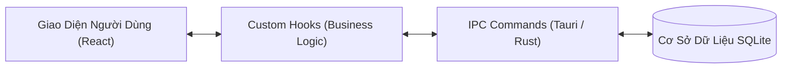

# KIẾN TRÚC TỔNG THỂ DỰ ÁN: [TÊN DỰ ÁN]

> **Phiên bản**: v1.0.0  
> **Cập nhật**: YYYY-MM-DD  

---

## 1. Ngăn Xếp Công Nghệ (Tech Stack)
- **Frontend**: TypeScript, React, Tailwind CSS, Lucide Icons.
- **Backend / Desktop**: Tauri (Rust) / SQLite.
- **Testing**: Pre-build Automated QA Life Cycle Suite (`tests/test_qa_lifecycle.ts`).

---

## 2. Ranh Giới Mô-Đun (Module Boundaries)
- Mọi tính năng nghiệp vụ nằm trong `src/modules/<feature>/` độc lập, chỉ giao tiếp ra bên ngoài qua Public API `index.ts`.
- Backend tương ứng nằm trong `src-tauri/src/<feature>.rs` độc lập.
- Tuyệt đối tuân thủ chuẩn `modular-architecture`: Cấm import sâu, cấm ký sinh tính năng.

---

## 3. Luồng Dữ Liệu Chính (Data Flow)

