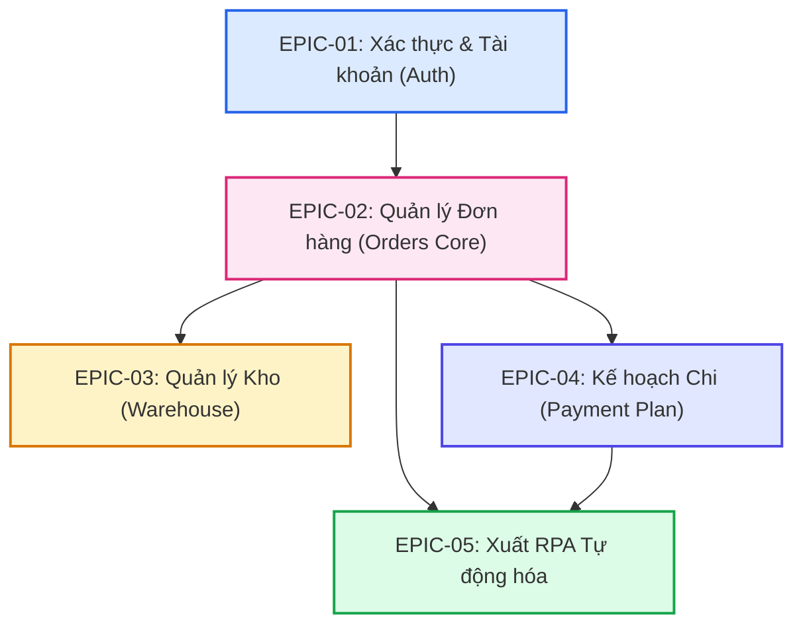

# [TÊN DỰ ÁN] - BẢN ĐỒ LỘ TRÌNH DỰ ÁN TỔNG THỂ (MASTER ROADMAP)

> **Trạng thái tổng thể**: `[DRAFT | IN_PROGRESS | STABLE | RELEASED]`  
> **Phiên bản hiện tại**: `vX.Y.Z`  
> **Cập nhật lần cuối**: `YYYY-MM-DD`  
> **Chủ quản dự án (Tech Lead / Architect)**: `[Tên hoặc AI Agent]`  

---

## 1. Tầm Nhìn Dự Án & Giá Trị Cốt Lõi (Vision & Objectives)

### 1.1. Mục tiêu kinh doanh & người dùng
- Mô tả tóm tắt mục đích cốt lõi của dự án và bài toán cần giải quyết.
- Đối tượng sử dụng chính và kỳ vọng năng suất đạt được.

### 1.2. Các chỉ số đo lường thành công (Success Metrics / KPIs)
- [ ] Thời gian xử lý hoặc phản hồi: `< X ms`
- [ ] Tỷ lệ lỗi cho phép: `0% Critical Defects`
- [ ] Độ bao phủ kiểm thử (Test Coverage): `100% Feature-Specific Verification`

---

## 2. Bảng Phân Rã Toàn Bộ Phân Hệ (Epic Breakdown Matrix)

> [!IMPORTANT]
> Mọi tính năng lớn trong dự án BẮT BUỘC phải được đăng ký vào bảng này trước khi viết code. Mỗi Epic sở hữu thư mục đặc tả riêng trong `docs/specs/features/<folder>/`.

| Mã Epic | Tên Phân Hệ / Tính Năng | Độ Ưu Tiên | Phụ Thuộc (Depends On) | Trạng Thái | Thư Mục Đặc Tả Chi Tiết |
| :--- | :--- | :--- | :--- | :--- | :--- |
| `EPIC-01` | [Ví dụ: Xác thực & Quản trị tài khoản] | `P0 (Critical)` | Không | `[x] COMPLETED` | [`features/01-auth/`](./features/01-auth/SPEC.md) |
| `EPIC-02` | [Ví dụ: Quản lý Đơn hàng & PO/OD] | `P0 (Critical)` | `EPIC-01` | `[/] IN_PROGRESS` | [`features/02-orders/`](./features/02-orders/SPEC.md) |
| `EPIC-03` | [Ví dụ: Quản lý Kho & Tồn kho] | `P1 (High)` | `EPIC-02` | `[ ] PENDING` | [`features/03-warehouse/`](./features/03-warehouse/SPEC.md) |
| `EPIC-04` | [Ví dụ: Kế hoạch Chi tiêu & Thanh toán] | `P1 (High)` | `EPIC-02` | `[ ] PENDING` | [`features/04-payment-plan/`](./features/04-payment-plan/SPEC.md) |
| `EPIC-05` | [Ví dụ: Xuất RPA & Tích hợp ngoài] | `P2 (Medium)` | `EPIC-02, EPIC-04` | `[ ] PENDING` | [`features/05-rpa/`](./features/05-rpa/SPEC.md) |

*Ghi chú độ ưu tiên: `P0`: Không thể thiếu (Blocker) | `P1`: Cần thiết cho vận hành | `P2`: Tối ưu / Mở rộng.*  
*Ghi chú trạng thái: `[ ] PENDING` (Chưa làm) | `[/] IN_PROGRESS` (Đang làm) | `[x] COMPLETED` (Đã nghiệm thu).*

---

## 3. Sơ Đồ Phụ Thuộc Phân Hệ (Dependency Graph)

---

## 4. Lộ Trình Phát Hành Theo Giai Đoạn (Milestones & Phases)

### Giai Đoạn 1: Nền Tảng Cốt Lõi (Phase 1 - Core MVP)
- **Mục tiêu**: Hoàn thiện toàn bộ khung kiến trúc, CSDL và các tính năng `P0`.
- **Epics bao gồm**: `EPIC-01`, `EPIC-02`.
- **Tiêu chí nghiệm thu cổng (Gate Criteria)**: 
  - Đầy đủ bộ test Tầng 0 đến Tầng 3 pass 100%.
  - Dữ liệu demo nạp thành công, không lỗi schema.
- **Trạng thái**: `[ ] ĐANG THỰC HIỆN | [x] ĐÃ HOÀN THÀNH`

### Giai Đoạn 2: Nghiệp Vụ Chuyên Sâu (Phase 2 - Advanced Operations)
- **Mục tiêu**: Hoàn thiện các nghiệp vụ xử lý thứ cấp và liên kết phân hệ.
- **Epics bao gồm**: `EPIC-03`, `EPIC-04`.
- **Tiêu chí nghiệm thu cổng**:
  - Không gây hồi quy (Zero Regression) lên Phase 1.
  - Bảo vệ số liệu chống ghi đè (Quantity Protection).
- **Trạng thái**: `[ ] CHƯA BẮT ĐẦU`

### Giai Đoạn 3: Tự Động Hóa & Tối Ưu Hóa (Phase 3 - Automation & Integration)
- **Mục tiêu**: Xuất dữ liệu RPA, kết nối API ngoài, tinh chỉnh hiệu năng.
- **Epics bao gồm**: `EPIC-05`.
- **Trạng thái**: `[ ] CHƯA BẮT ĐẦU`

---

## 5. Quy Chuẩn Kỹ Thuật Dự Án (Cross-Cutting Engineering Standards)

Mọi phân hệ trong lộ trình trên đều phải tuân thủ tuyệt đối:
1. **Kiến Trúc Module Hóa (`modular-architecture`)**: Mỗi tính năng là 1 module độc lập, cấm ký sinh, cấm import sâu qua ranh giới.
2. **Hệ Thống Thiết Kế Giao Diện (`ui-design-system`)**: Tái sử dụng 100% component UI nguyên tử, đủ 4 trạng thái UI.
3. **Quy Trình Kiểm Thử (`qa-verification`)**: Đạt 100% test pass trước khi chuyển Phase hoặc đóng gói.
4. **Cổng Xác Nhận Tường Minh (`explicit-confirmation-gate`)**: Dừng lại chờ lệnh xác nhận trực tiếp của người dùng trước khi triển khai code.

---

## 6. Nhật Ký Lịch Sử Thay Đổi Lộ Trình (Roadmap Change Log)

| Ngày | Phiên Bản | Người Thay Đổi | Nội Dung Điều Chỉnh | Lý Do |
| :--- | :--- | :--- | :--- | :--- |
| `YYYY-MM-DD` | `v1.0.0` | `Agent/Lead` | Khởi tạo Master Roadmap ban đầu | Thiết lập khung dự án |
