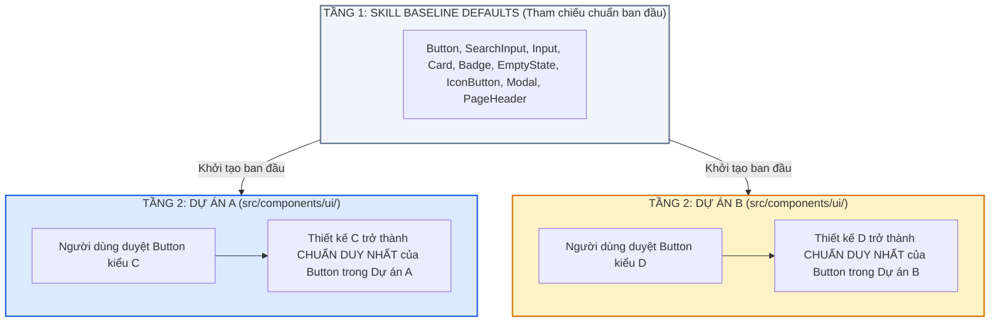

# UI Design System & Project-Level Component Standardization Skill

Bộ kỹ năng này là **Cổng Kiến Trúc Giao Diện Bắt Buộc (Mandatory UI Architectural Gate)** nhằm thiết lập và duy trì **Tính Nhất Quán 100% (100% UI Consistency)**, chuẩn hóa Design Tokens, bắt buộc lập bản đặc tả hệ thống thiết kế trước khi viết code, tái sử dụng triệt để Atomic Components và đảm bảo mỗi dự án sở hữu một bộ Component chuẩn mực độc lập không bao giờ nhầm lẫn.

---

## 0. Quy Tắc Bất Biến Bắt Buộc (Non-Negotiable Core Invariants)

### 0.0 📜 CỔNG ĐẶC TẢ HỆ THỐNG THIẾT KẾ TRƯỚC KHI CODE (PRE-CODE DESIGN SYSTEM SPECIFICATION GATE)
**QUY TẮC BẤT DI BẤT DỊCH**: Trước khi bắt đầu viết dòng code đầu tiên (hoặc khi khởi tạo dự án mới, khi thiết kế phân hệ giao diện mới):
1. **BẮT BUỘC TẠO FILE DESIGN SYSTEM SPECIFICATION**:
   - AI **TUYỆT ĐỐI KHÔNG ĐƯỢC PHÉP** viết bất kỳ file code dự án nào (`.tsx`, `.ts`, `.vue`, `.jsx`, `.rs`) khi chưa tạo tệp đặc tả hệ thống thiết kế (ví dụ: `docs/design_system_specification.md` hoặc `mockup/design_system_specification.html`).
   - Bản đặc tả bắt buộc phải bao gồm đầy đủ 4 trụ cột:
     - **Trụ cột 1: Design Tokens**: Bảng màu ngữ nghĩa (Brand, Semantic colors), Typography (Font gia đình, Scale kích thước, Weight độ đậm), Spacing Grid (bội số của 4px), Radius Hierarchy (`rounded-xl`, `rounded-2xl`, `rounded-3xl`), Shadows (`shadow-xs`, `shadow-hud`).
     - **Trụ cột 2: Component Inventory & Matrix (Danh mục thành phần)**: Danh sách kiểm kê toàn bộ các Atomic Components sẽ sử dụng trong dự án (`SearchInput`, `EmptyState`, `IconButton`, `Button`, `Switch`, `Select`, `PillTabs`, `Input`, `Card`, `Badge`, `Modal`...) với đầy đủ các kích cỡ (`sm`/`md`/`lg`), biến thể (variants), và trạng thái (Default, Hover, Active, Disabled, Loading, Error).
     - **Trụ cột 3: API & Data Contract**: Định nghĩa cấu trúc dữ liệu, Props, Callbacks giữa UI và Backend/Core logic để đảm bảo Frontend & Backend có thể phát triển song song mà không cần chờ đợi.
     - **Trụ cột 4: Interactive Showcase Mockup**: Dựng tệp Mockup HTML tương tác sống (offline-first) để người dùng có thể mở trực tiếp trên trình duyệt bấm thử, gõ thử, kiểm tra trải nghiệm trước khi duyệt.
2. **CỔNG CHỜ PHÊ DUYỆT TỪ NGƯỜI DÙNG (MANDATORY USER APPROVAL GATE)**:
   - Sau khi tạo xong file Design System Specification và Mockup, AI **BẮT BUỘC PHẢI DỪNG LẠI, KHÔNG GỌI THÊM BẤT KỲ TOOL CODE NÀO**.
   - Xuất trình đường dẫn tệp đặc tả và mockup, hỏi rõ ràng:
     > *"Em đã lập xong bản Design System Specification và Mockup tương tác cho dự án. Mời anh xem qua và xác nhận: Anh có duyệt bộ tiêu chuẩn thiết kế này làm chuẩn duy nhất cho dự án để bắt đầu tiến hành viết code thiết lập dự án không?"*
   - **CHỈ KHI VÀ CHỈ KHI** nhận được câu lệnh xác nhận/phê duyệt rõ ràng từ người dùng (ví dụ: *"Duyệt em nhé"*, *"Triển khai đi em"*), AI mới được phép bắt đầu viết dòng code dự án đầu tiên!

---

### 0.1 ❌ LỆNH CẤM THẺ RAW HTML (ZERO-RAW-HTML INVARIANCE)
Trong mọi trang (Pages), phân hệ (Modules), màn hình (Views), hộp thoại (Modals):
- **TUYỆT ĐỐI CẤM** việc viết trực tiếp các thẻ HTML thô:
  - ❌ CẤM `<input className="...">` $\rightarrow$ **BẮT BUỘC DÙNG `<SearchInput />` hoặc `<Input />`** từ `@/components/ui`.
  - ❌ CẤM `<button className="...">` $\rightarrow$ **BẮT BUỘC DÙNG `<Button />` hoặc `<IconButton />`** từ `@/components/ui`.
  - ❌ CẤM `<select className="...">` $\rightarrow$ **BẮT BUỘC DÙNG `<Select />`** từ `@/components/ui`.
  - ❌ CẤM `
` $\rightarrow$ **BẮT BUỘC DÙNG `<EmptyState />`** từ `@/components/ui`.
  - ❌ CẤM popup/modal tự chế $\rightarrow$ **BẮT BUỘC DÙNG `<Modal />`** từ `@/components/ui`.
- Mọi tương tác giao diện bắt buộc phải đi qua các khối nguyên tử được định nghĩa tại `@/components/ui`.

---

### 0.2 🏛️ KIẾN TRÚC HAI TẦNG & CHUẨN HÓA THEO TỪNG DỰ ÁN (DUAL-TIER PROJECT-LEVEL INVARIANCE)
Hệ thống vận hành theo cơ chế 2 tầng phân tách độc lập:

1. **Tầng 1 - Thư viện Tham Chiếu Chuẩn Ban Đầu (Skill Baseline Defaults)**:
   - Skill cung cấp bộ Component mẫu chuẩn mực ban đầu (chuẩn Raycast/Linear, height 44-48px, `rounded-2xl`, Design Tokens tối ưu).
   - Đóng vai trò là "bộ gen chuẩn" khi dự án mới chưa có thiết kế riêng.

2. **Tầng 2 - Chuẩn Được Duyệt Của Từng Dự Án (Project-Approved Standard - Single Source of Truth)**:
   - Khi người dùng yêu cầu thiết kế lại một Component trong một dự án cụ thể (ví dụ Dự án A duyệt kiểu thiết kế C cho `Button`):
     $\rightarrow$ **Kể từ thời điểm đó về sau, thiết kế C luôn là Component chuẩn mặc định cho toàn bộ Dự án A**.
     Tất cả các màn hình, phân hệ cũ và mới trong Dự án A khi gọi `Button` đều kế thừa chuẩn C.
   - Tương tự, nếu Dự án B duyệt kiểu thiết kế D cho `Button` $\rightarrow$ Dự án B vĩnh viễn dùng thiết kế D.
   - **Hai dự án A và B có thể chạy song song mà không bao giờ bị nhầm lẫn hay ghi đè thiết kế của nhau**, vì mã nguồn chuẩn của từng dự án được lưu trữ độc lập tại `src/components/ui/` của chính dự án đó!

---

### 0.3 🛑 CỔNG XÁC NHẬN CHUẨN DỰ ÁN CHO COMPONENT MỚI (FIRST-DESIGN STANDARDIZATION APPROVAL GATE)
Bất cứ khi nào phát sinh một Component tương tác:
1. **Kiểm tra**: Nếu Component đó **chưa có trong thư viện của Skill** hoặc **chưa được thiết lập chuẩn cho dự án hiện tại**:
2. **Quy tắc bắt buộc**: Khi thiết kế lần đầu, **AI LUÔN PHẢI HỎI VÀ XÁC NHẬN VỚI NGƯỜI DÙNG**:
   > *"Anh có muốn lấy thiết kế [Tên_Component] này làm Component chuẩn cho toàn bộ dự án hiện tại không?"*
3. **Sau khi người dùng xác nhận ĐỒNG Ý**:
   - AI lập tức tạo hoặc cập nhật file Component tại `src/components/ui/[ComponentName].tsx`.
   - Xuất khẩu chính thức tại `src/components/ui/index.ts`.
   - Kể từ đó về sau, Component này chính thức trở thành chuẩn bất biến cho toàn bộ dự án. Tuyệt đối cấm tạo các biến thể ad-hoc rời rạc ở các màn hình khác!

---

### 0.4 🚫 LỆNH CẤM SIBLING SPACING TRÊN MULTI-VIEW CONTAINER (ZERO-SIBLING-SPACING ON TAB SWITCHERS)
Khi một container cha chứa các view, phân hệ, hoặc panel con được chuyển đổi ẩn/hiện (`hidden`, `display: none`, hoặc conditional tabs):
1. **TUYỆT ĐỐI CẤM DÙNG `space-y-*`, `space-x-*` HOẶC `gap-*` (TRÊN FLEX/GRID CÓ CHỨA CÁC THẺ ẨN HIỆN)**:
   - Các bộ chọn khoảng cách anh-chị-em của CSS (như `> :not([hidden]) ~ :not([hidden])` hoặc `> * + *` của Tailwind CSS) sẽ gây ra **Lỗi Lệch Vị Trí Kinh Điển**:
     - Panel con thứ nhất (`:first-child`) có `margin-top: 0px`.
     - Panel con thứ 2, 3, 4 khi được kích hoạt (`display: block`) lại là con thứ 2, 3, 4 trong DOM $\rightarrow$ bị trình duyệt ép nhận `margin-top: 1rem` ($+16\text{px}$ đến $+18\text{px}$), khiến vị trí tiêu đề của các bảng sau luôn bị tụt sâu hơn bảng đầu tiên!
2. **GIẢI PHÁP BẮT BUỘC (SELF-CONTAINED PANEL BOUNDING)**:
   - Thẻ cha bao bọc danh sách các panel chỉ giữ vai trò là khung cuộn (`overflow-y-auto`) và đệm lề ngoài (`p-6` hoặc `p-8`).
   - Tuyệt đối cấm đặt bất kỳ tiện ích `space-y-*` nào lên thẻ cha này.
   - Mỗi panel con phải là một khối độc lập hoàn chỉnh (`margin-top: 0`), tự quản lý khoảng cách nội bộ của chính mình.

---

### 0.5 📏 BẤT BIẾN TỌA ĐỘ VÀ CHIỀU CAO HEADER TRÊN CÁC PANEL NGANG HÀNG (PEER VIEW COORDINATE INVARIANCE)
Trong mọi giao diện có nhiều phân mục hoặc tab ngang hàng (ví dụ: Chrome Settings, Preferences, Dashboard Tabs, Master-Detail):
1. **BẤT BIẾN TỌA ĐỘ TRỤC Y (PIXEL-PERFECT Y COORDINATE)**:
   - Tọa độ $Y$ bắt đầu của Tiêu đề Panel (`titleTop`) và tọa độ $Y$ bắt đầu của Thẻ Nội Dung đầu tiên (`cardTop`) **BẮT BUỘC PHẢI BẰNG NHAU 100% TRÊN TẤT CẢ CÁC PANEL**.
   - Bấm chuyển qua bất kỳ bảng nào, mắt người dùng tuyệt đối không được thấy hiện tượng tiêu đề hoặc thẻ bên dưới bị nhảy lên nhảy xuống hay thụt thò.
2. **CHUẨN HÓA KHUNG HEADER PANEL (STANDARDIZED HEADER CONTAINER)**:
   - Header của mọi panel ngang hàng phải tuân thủ cùng một cấu trúc kích thước:
     - Tiêu đề: Đặt ngắn gọn, súc tích, cùng cấp độ font (`text-base font-bold leading-none`).
     - Dòng mô tả (Subtitle): Chuẩn hóa số dòng hiển thị tương đương (hoặc cố định `min-height` của header) để triệt tiêu hiệu ứng Domino xê dịch thẻ card bên dưới.
3. **BẮT BUỘC RESET VỊ TRÍ CUỘN KHI ĐỔI TAB (`scrollTop = 0`)**:
   - Khi người dùng click chuyển sang tab hoặc panel khác, code xử lý chuyển tab **BẮT BUỘC** phải gọi:
     `scrollContainer.scrollTop = 0;`
   - Điều này triệt tiêu hoàn toàn lỗi lưu vết cuộn từ tab trước làm xô lệch tab kế tiếp.
4. **HIỆU ỨNG CHUYỂN TAB THUẦN TÚY OPACITY (ZERO-TRANSLATE ANIMATION)**:
   - Khi chuyển panel, chỉ sử dụng hiệu ứng mờ dần thuần túy (`opacity` fade-in từ 0 đến 1).
   - **TUYỆT ĐỐI CẤM** dùng `translateY` hoặc `translateX` trong animation chuyển tab vì sẽ gây ra hiện tượng giật cục vị trí pixel giữa các lần nhấp chuột.

---

## 1. Danh Mục Các Khối Nguyên Tử Cốt Lõi Tại `@/components/ui`

Mọi dự án frontend chuẩn mực đều sở hữu tối thiểu 9 khối nguyên tử:

| Component | Mục đích sử dụng | Quy chuẩn kích thước & hình học |
| :--- | :--- | :--- |
| **`<SearchInput />`** | Thanh tìm kiếm, ô lọc dữ liệu, ô search đa chiều | Chiều cao chuẩn **44px** (desktop) hoặc **48px**, bo góc `rounded-2xl`, icon kính lúp trái, nút xóa nhanh (`X`), slot nút hành động phải (`actionButton`), `shadow-xs`. |
| **`<Input />`** | Ô nhập văn bản, số, mật khẩu, form dữ liệu | Chiều cao 40px, bo góc `rounded-xl` hoặc `rounded-2xl`, label rõ ràng, hỗ trợ icon prefix/suffix và thông báo lỗi. |
| **`<Button />`** | Nút bấm hành động chính/phụ | `primary`, `secondary`, `outline`, `ghost`, `danger`, `success`. Chiều cao `sm` (32px), `md` (40px), `lg` (46px). Bo góc `rounded-xl`/`rounded-2xl`. Hỗ trợ `loading` spinner. |
| **`<IconButton />`** | Nút icon thao tác nhanh trên dòng (phát âm, xóa, sửa, sao chép) | Vuông chuẩn `32x32px` hoặc `36x36px`, bo góc `rounded-xl`, màu hover nhẹ nhàng `hover:bg-slate-100` hoặc `hover:bg-blue-50`, tooltip gợi ý. |
| **`<Card />`** | Khung chứa nội dung, panel, container | Bo góc `rounded-2xl` hoặc `rounded-3xl`, viền mảnh `border-slate-200/80`, biến thể `default`, `flat`, `bordered`, `dashed`, `hud`. |
| **`<EmptyState />`** | Trạng thái chưa có dữ liệu (ảnh 3) | Khung viền nét đứt `border-2 border-dashed border-slate-200`, icon tròn nổi bật `w-12 h-12`, tiêu đề in đậm, mô tả hướng dẫn thao tác, nút kêu gọi hành động (CTA). |
| **`<Badge />`** | Nhãn trạng thái, cấp độ, phân loại | Bo góc `rounded-xl` hoặc `rounded-full`, màu ngữ nghĩa (`brand`, `success`, `warning`, `danger`, `info`), hỗ trợ chấm tròn `dot`. |
| **`<Modal />`** | Cửa sổ hộp thoại popup, xác nhận, nhập liệu | Lớp phủ nền mờ `backdrop-blur-xs`, hộp thoại bo góc `rounded-3xl`, bóng đổ lớn `shadow-2xl`, nút đóng `X`, hỗ trợ phím `Escape`. |
| **`<PageHeader />`** | Tiêu đề trang đồng nhất | Tiêu đề `text-lg font-bold`, mô tả `text-xs text-slate-500`, dải nút thao tác bên phải. |

---

## 2. Hệ Thống Semantic Design Tokens Chuẩn

1. **Màu sắc ngữ nghĩa (Color Palette)**:
   - **Primary / Brand**: `blue-600` (hover: `blue-700`, active: `blue-800`, light: `blue-50`).
   - **Success**: `emerald-600` (light: `emerald-50`, border: `emerald-200`).
   - **Warning**: `amber-500` (light: `amber-50`, border: `amber-200`).
   - **Danger / Error**: `rose-600` (light: `rose-50`, border: `rose-200`).
   - **Neutral / Text**: Tiêu đề `text-slate-900`, nội dung `text-slate-700`, mô tả phụ `text-slate-500`, viền `border-slate-200`.

2. **Hệ thống Bo Góc (Border Radius Discipline)**:
   - `rounded-xl` (12px): Badges, inputs compact, icon buttons.
   - `rounded-2xl` (16px): Primary buttons, search inputs, standard cards, list items.
   - `rounded-3xl` (24px): Page containers, modal dialogs, large data tables.

3. **Hệ thống Khoảng Cách (Spacing Grid - Bội số của 4px)**:
   - `gap-2` (8px), `gap-3` (12px), `gap-4` (16px), `gap-6` (24px).
   - Padding container: `p-4` (16px) hoặc `p-6` (24px).

---

## 3. CỔNG CHẶN KIỂM THỬ GIAO DIỆN TỰ ĐỘNG (AUTOMATED UI TEST GATE)

Liên kết với `qa-verification` (Tầng 3):
1. **Quét cấm thẻ HTML thô (Static Lint Gate)**:
   - Bộ test tự động quét các file trong `src/modules/`: Nếu phát hiện thẻ raw `<input` hoặc `<button` được viết tùy tiện ngoài `@/components/ui` $\rightarrow$ **TEST SUITE BÁO FAIL NGAY LẬP TỨC**.
2. **Kiểm tra xuất khẩu `@/components/ui/index.ts`**:
   - Bắt buộc mọi Atomic Component chuẩn của dự án phải được đăng ký và xuất khẩu qua `index.ts`.
3. **Bảo vệ tính toàn vẹn Zero-Regression**:
   - Khi chỉnh sửa giao diện của một phân hệ, tuyệt đối không làm thay đổi props hoặc giao diện của các component dùng chung mà chưa được người dùng phê duyệt.
4. **Kiểm tra Tọa độ Bố cục trên Mockup (Mockup Pixel Coordinate Verification)**:
   - Khi dựng file Mockup tương tác trước khi trình bày cho người dùng, AI phải tự giác kiểm tra hoặc chạy script đo đạc tọa độ Y (`getBoundingClientRect().top`) của từng tab/panel ngang hàng để đảm bảo độ cân bằng và đồng nhất 100% về khoảng cách.
