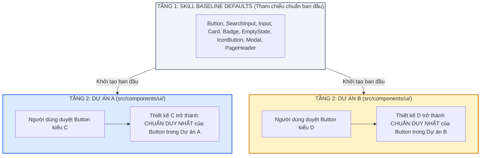

# UI Design System & Project-Level Component Standardization Skill

Bộ kỹ năng này là **Cổng Kiến Trúc Giao Diện Bắt Buộc (Mandatory UI Architectural Gate)** nhằm thiết lập và duy trì **Tính Nhất Quán 100% (100% UI Consistency)**, chuẩn hóa Design Tokens, tái sử dụng triệt để Atomic Components và đảm bảo mỗi dự án sở hữu một bộ Component chuẩn mực độc lập không bao giờ nhầm lẫn.

---

## 0. Quy Tắc Bất Biến Bắt Buộc (Non-Negotiable Core Invariants)

### 0.1 ❌ LỆNH CẤM THẺ RAW HTML (ZERO-RAW-HTML INVARIANCE)
Trong mọi trang (Pages), phân hệ (Modules), màn hình (Views), hộp thoại (Modals):
- **TUYỆT ĐỐI CẤM** việc viết trực tiếp các thẻ HTML thô:
  - ❌ CẤM `<input className="...">` $\rightarrow$ **BẮT BUỘC DÙNG `<SearchInput />` hoặc `<Input />`** từ `@/components/ui`.
  - ❌ CẤM `<button className="...">` $\rightarrow$ **BẮT BUỘC DÙNG `<Button />` hoặc `<IconButton />`** từ `@/components/ui`.
  - ❌ CẤM `<select className="...">` $\rightarrow$ **BẮT BUỘC DÙNG `<Select />`** từ `@/components/ui`.
  - ❌ CẤM `
` $\rightarrow$ **BẮT BUỘC DÙNG `<EmptyState />`** từ `@/components/ui`.
  - ❌ CẤM popup/modal tự chế $\rightarrow$ **BẮT BUỘC DÙNG `<Modal />`** từ `@/components/ui`.
- Mọi tương tác giao diện bắt buộc phải đi qua các khối nguyên tử được định nghĩa tại `@/components/ui`.

---

### 0.2 🏛️ KIẾN TRÚC HAI TẦNG & CHUẨN HÓA THEO TỪNG DỰ ÁN (DUAL-TIER PROJECT-LEVEL INVARIANCE)
Hệ thống vận hành theo cơ chế 2 tầng phân tách độc lập:

1. **Tầng 1 - Thư viện Tham Chiếu Chuẩn Ban Đầu (Skill Baseline Defaults)**:
   - Skill cung cấp bộ Component mẫu chuẩn mực ban đầu (chuẩn Raycast/Linear, height 44-48px, `rounded-2xl`, Design Tokens tối ưu).
   - Đóng vai trò là "bộ gen chuẩn" khi dự án mới chưa có thiết kế riêng.

2. **Tầng 2 - Chuẩn Được Duyệt Của Từng Dự Án (Project-Approved Standard - Single Source of Truth)**:
   - Khi người dùng yêu cầu thiết kế lại một Component trong một dự án cụ thể (ví dụ Dự án A duyệt kiểu thiết kế C cho `Button`):
     $\rightarrow$ **Kể từ thời điểm đó về sau, thiết kế C luôn là Component chuẩn mặc định cho toàn bộ Dự án A**.
     Tất cả các màn hình, phân hệ cũ và mới trong Dự án A khi gọi `Button` đều kế thừa chuẩn C.
   - Tương tự, nếu Dự án B duyệt kiểu thiết kế D cho `Button` $\rightarrow$ Dự án B vĩnh viễn dùng thiết kế D.
   - **Hai dự án A và B có thể chạy song song mà không bao giờ bị nhầm lẫn hay ghi đè thiết kế của nhau**, vì mã nguồn chuẩn của từng dự án được lưu trữ độc lập tại `src/components/ui/` của chính dự án đó!

---

### 0.3 🛑 CỔNG XÁC NHẬN CHUẨN DỰ ÁN CHO COMPONENT MỚI (FIRST-DESIGN STANDARDIZATION APPROVAL GATE)
Bất cứ khi nào phát sinh một Component tương tác:
1. **Kiểm tra**: Nếu Component đó **chưa có trong thư viện của Skill** hoặc **chưa được thiết lập chuẩn cho dự án hiện tại**:
2. **Quy tắc bắt buộc**: Khi thiết kế lần đầu, **AI LUÔN PHẢI HỎI VÀ XÁC NHẬN VỚI NGƯỜI DÙNG**:
   > *"Anh có muốn lấy thiết kế [Tên_Component] này làm Component chuẩn cho toàn bộ dự án hiện tại không?"*
3. **Sau khi người dùng xác nhận ĐỒNG Ý**:
   - AI lập tức tạo hoặc cập nhật file Component tại `src/components/ui/[ComponentName].tsx`.
   - Xuất khẩu chính thức tại `src/components/ui/index.ts`.
   - Kể từ đó về sau, Component này chính thức trở thành chuẩn bất biến cho toàn bộ dự án. Tuyệt đối cấm tạo các biến thể ad-hoc rời rạc ở các màn hình khác!

---

## 1. Danh Mục Các Khối Nguyên Tử Cốt Lõi Tại `@/components/ui`

Mọi dự án frontend chuẩn mực đều sở hữu tối thiểu 9 khối nguyên tử:

| Component | Mục đích sử dụng | Quy chuẩn kích thước & hình học |
| :--- | :--- | :--- |
| **`<SearchInput />`** | Thanh tìm kiếm, ô lọc dữ liệu, ô search đa chiều | Chiều cao chuẩn **44px** (desktop) hoặc **48px**, bo góc `rounded-2xl`, icon kính lúp trái, nút xóa nhanh (`X`), slot nút hành động phải (`actionButton`), `shadow-xs`. |
| **`<Input />`** | Ô nhập văn bản, số, mật khẩu, form dữ liệu | Chiều cao 40px, bo góc `rounded-xl` hoặc `rounded-2xl`, label rõ ràng, hỗ trợ icon prefix/suffix và thông báo lỗi. |
| **`<Button />`** | Nút bấm hành động chính/phụ | `primary`, `secondary`, `outline`, `ghost`, `danger`, `success`. Chiều cao `sm` (32px), `md` (40px), `lg` (46px). Bo góc `rounded-xl`/`rounded-2xl`. Hỗ trợ `loading` spinner. |
| **`<IconButton />`** | Nút icon thao tác nhanh trên dòng (phát âm, xóa, sửa, sao chép) | Vuông chuẩn `32x32px` hoặc `36x36px`, bo góc `rounded-xl`, màu hover nhẹ nhàng `hover:bg-slate-100` hoặc `hover:bg-blue-50`, tooltip gợi ý. |
| **`<Card />`** | Khung chứa nội dung, panel, container | Bo góc `rounded-2xl` hoặc `rounded-3xl`, viền mảnh `border-slate-200/80`, biến thể `default`, `flat`, `bordered`, `dashed`, `hud`. |
| **`<EmptyState />`** | Trạng thái chưa có dữ liệu (ảnh 3) | Khung viền nét đứt `border-2 border-dashed border-slate-200`, icon tròn nổi bật `w-12 h-12`, tiêu đề in đậm, mô tả hướng dẫn thao tác, nút kêu gọi hành động (CTA). |
| **`<Badge />`** | Nhãn trạng thái, cấp độ, phân loại | Bo góc `rounded-xl` hoặc `rounded-full`, màu ngữ nghĩa (`brand`, `success`, `warning`, `danger`, `info`), hỗ trợ chấm tròn `dot`. |
| **`<Modal />`** | Cửa sổ hộp thoại popup, xác nhận, nhập liệu | Lớp phủ nền mờ `backdrop-blur-xs`, hộp thoại bo góc `rounded-3xl`, bóng đổ lớn `shadow-2xl`, nút đóng `X`, hỗ trợ phím `Escape`. |
| **`<PageHeader />`** | Tiêu đề trang đồng nhất | Tiêu đề `text-lg font-bold`, mô tả `text-xs text-slate-500`, dải nút thao tác bên phải. |

---

## 2. Hệ Thống Semantic Design Tokens Chuẩn

1. **Màu sắc ngữ nghĩa (Color Palette)**:
   - **Primary / Brand**: `blue-600` (hover: `blue-700`, active: `blue-800`, light: `blue-50`).
   - **Success**: `emerald-600` (light: `emerald-50`, border: `emerald-200`).
   - **Warning**: `amber-500` (light: `amber-50`, border: `amber-200`).
   - **Danger / Error**: `rose-600` (light: `rose-50`, border: `rose-200`).
   - **Neutral / Text**: Tiêu đề `text-slate-900`, nội dung `text-slate-700`, mô tả phụ `text-slate-500`, viền `border-slate-200`.

2. **Hệ thống Bo Góc (Border Radius Discipline)**:
   - `rounded-xl` (12px): Badges, inputs compact, icon buttons.
   - `rounded-2xl` (16px): Primary buttons, search inputs, standard cards, list items.
   - `rounded-3xl` (24px): Page containers, modal dialogs, large data tables.

3. **Hệ thống Khoảng Cách (Spacing Grid - Bội số của 4px)**:
   - `gap-2` (8px), `gap-3` (12px), `gap-4` (16px), `gap-6` (24px).
   - Padding container: `p-4` (16px) hoặc `p-6` (24px).

---

## 3. CỔNG CHẶN KIỂM THỬ GIAO DIỆN TỰ ĐỘNG (AUTOMATED UI TEST GATE)

Liên kết với `qa-verification` (Tầng 3):
1. **Quét cấm thẻ HTML thô (Static Lint Gate)**:
   - Bộ test tự động quét các file trong `src/modules/`: Nếu phát hiện thẻ raw `<input` hoặc `<button` được viết tùy tiện ngoài `@/components/ui` $\rightarrow$ **TEST SUITE BÁO FAIL NGAY LẬP TỨC**.
2. **Kiểm tra xuất khẩu `@/components/ui/index.ts`**:
   - Bắt buộc mọi Atomic Component chuẩn của dự án phải được đăng ký và xuất khẩu qua `index.ts`.
3. **Bảo vệ tính toàn vẹn Zero-Regression**:
   - Khi chỉnh sửa giao diện của một phân hệ, tuyệt đối không làm thay đổi props hoặc giao diện của các component dùng chung mà chưa được người dùng phê duyệt.
